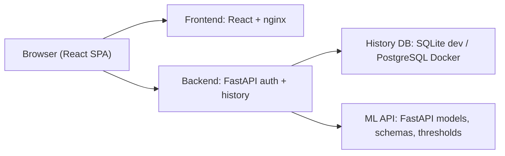
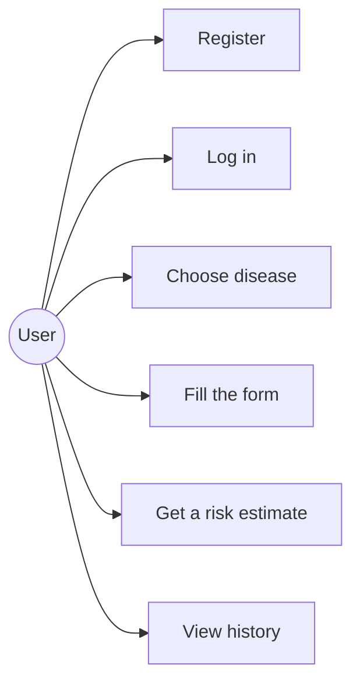
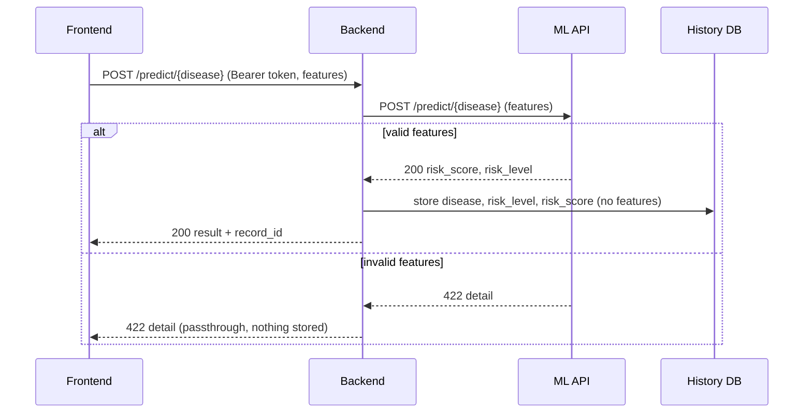
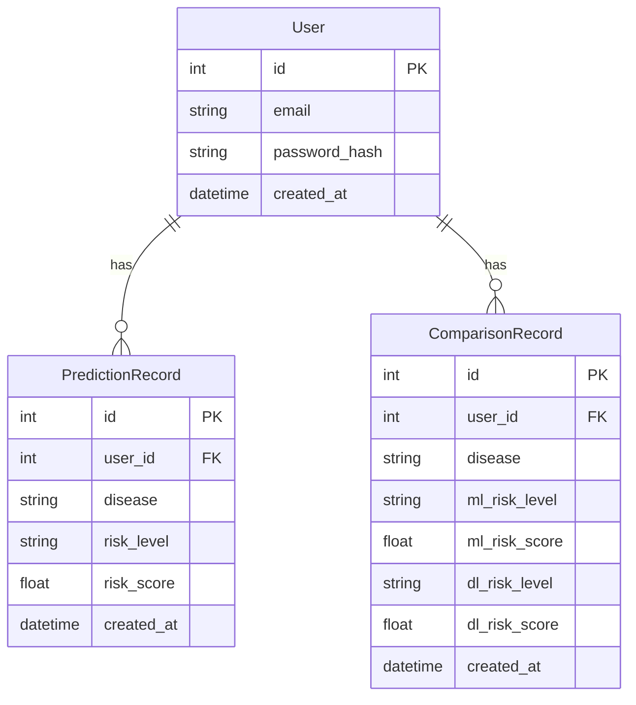
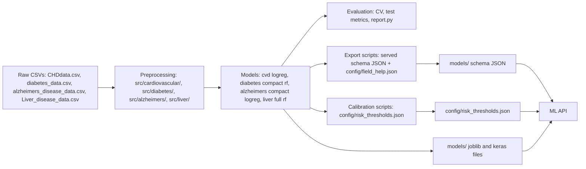
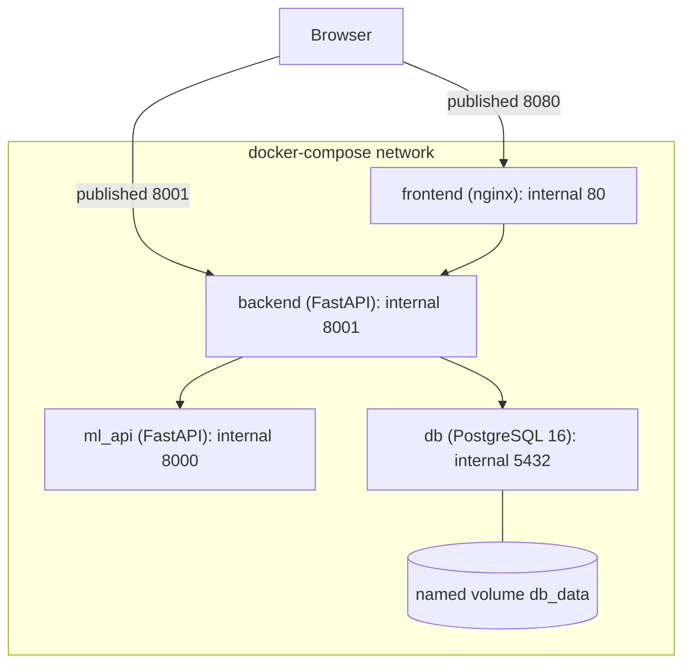

# Architecture

This document describes the MultiRisk AI MVP as it is implemented in this repository.
Endpoint fields, ports, and storage details are read from the code
(`src/ml_api/main.py`, `src/backend/main.py`, `src/export_artifacts.py`,
`docker-compose.yml`); field ranges come from the served schema JSON files;
frontend behavior comes from `frontend/src/derived.js`, `frontend/src/pages/Home.jsx`,
and `frontend/src/pages/Predict.jsx`; test and CI details come from `tests/`,
`frontend/src/`, `scripts/smoke_test.py`, and `.github/workflows/ci.yml`.

## 1. Overview

MultiRisk AI estimates the **current** risk of four diseases from cross-sectional
data: Type 2 Diabetes, Cardiovascular Disease (CVD), Alzheimer's disease, and
liver disease. The API keys are `cvd`, `diabetes`, `alzheimers`, and `liver`, in
that order in the ML API health response. It is a small service-oriented
application:

- A **browser** loads a React single-page app served by nginx.
- The **frontend** (nginx) serves static files and calls the **backend** over REST/JSON.
- The **backend** (FastAPI) handles authentication and prediction history, and
  proxies prediction and schema requests to the **ML API**.
- The **ML API** (FastAPI) loads trained ML and MLP models, schemas, metrics, and
  separate ML/DL thresholds from disk and returns risk scores and levels.
- The **history database** stores users and prediction records. It is SQLite in
  development (the backend default `DATABASE_URL` is `sqlite:///./backend.db`) and
  PostgreSQL in Docker (`postgresql+psycopg://...`).

### Component diagram



## 2. Use cases

The single actor is the User. The disease choice is one of `cvd`, `diabetes`,
`alzheimers`, and `liver`.



## 3. Prediction sequence

The frontend selects one of `cvd`, `diabetes`, `alzheimers`, and `liver`, then
the backend forwards the feature payload to the ML API. On success it stores a
record that contains only the disease, risk level, and risk score (never the
input features). On a `422` from the ML API it passes the error through and
stores nothing.



## 4. Data model

Three tables, read from `src/backend/main.py`. The `disease` column in both
record tables holds one of `cvd`, `diabetes`, `alzheimers`, and `liver`.



`email` is unique and indexed. `password_hash` stores a bcrypt hash.
`created_at` is set to the current UTC time on insert.

## 5. Training and export data flow

Offline scripts produce the files that the ML API loads at startup. Shared steps
live in `src/baselines.py`, `src/mlp.py`, `src/report.py`,
`src/family_history_check.py`, `src/calibrate_thresholds.py`,
`src/export_artifacts.py`, and `src/eda.py`. The disease-specific preprocessing
and analysis pipelines are `src/cardiovascular/preprocess.py` for `cvd`,
`src/diabetes/preprocess.py` for `diabetes`, `src/alzheimers/` for `alzheimers`,
and `src/liver/` for `liver`.

| Disease | Served schema | Served model | Served scaler | `model_name` |
|---------|---------------|--------------|---------------|--------------|
| `cvd` | `models/cardiovascular/schema_cvd.json` | `models/cardiovascular/final_cvd.joblib` | `models/cardiovascular/scaler_cvd.joblib` | `logreg` |
| `diabetes` | `models/diabetes/schema_diabetes_compact.json` | `models/diabetes/final_diabetes_compact.joblib` | `models/diabetes/scaler_diabetes_compact.joblib` | `rf` |
| `alzheimers` | `models/alzheimers/schema_alzheimers_compact.json` | `models/alzheimers/final_alzheimers_compact.joblib` | `models/alzheimers/scaler_alzheimers_compact.joblib` | `logreg` |
| `liver` | `models/liver/schema_liver_full.json` | `models/liver/final_liver_full.joblib` | `models/liver/scaler_liver_full.joblib` | `rf` |

The same served feature columns and scalers are used by the deployed MLP models:

| Disease | Served MLP |
|---------|------------|
| `cvd` | `models/cardiovascular/mlp_cvd.keras` |
| `diabetes` | `models/diabetes/mlp_diabetes_compact.keras` |
| `alzheimers` | `models/alzheimers/mlp_alzheimers_compact.keras` |
| `liver` | `models/liver/mlp_liver_full.keras` |

`src/deep_serving.py` trains those MLPs, writes
`config/dl_risk_thresholds.json`, and writes `config/comparison_metrics.json`.



## 6. Deployment (local docker-compose)

The stack runs with `docker compose`. Only the frontend and backend are published
to the host; the ML API and the database stay on the internal network. The ML API
serves artifacts for `cvd`, `diabetes`, `alzheimers`, and `liver`.



Port and volume details:

| Service | Image / build | Internal port | Published to host | Notes |
|---------|---------------|---------------|-------------------|-------|
| frontend | `docker/frontend.Dockerfile` (nginx) | 80 | `${FRONTEND_PORT:-8080}` | serves the built SPA |
| backend | `docker/backend.Dockerfile` | 8001 | 8001 | `depends_on` ml_api (healthy) and db (healthy) |
| ml_api | `docker/ml.Dockerfile` | 8000 | none | healthcheck on `/health` |
| db | `postgres:16-alpine` | 5432 | none | named volume `db_data`, `pg_isready` healthcheck |

Backend environment in compose: `ENVIRONMENT=${ENVIRONMENT:-production}`,
`DATABASE_URL=postgresql+psycopg://...`, `ML_API_URL=http://ml_api:8000`,
`JWT_SECRET=${JWT_SECRET:?set JWT_SECRET}`,
`CORS_ORIGINS=${CORS_ORIGINS:-http://localhost:${FRONTEND_PORT:-8080}}`.

**AWS deployment is planned future work and is not implemented.** The repository
contains only the local docker-compose stack above; there are no AWS, Terraform,
or cloud deployment files.

## 7. API contract

| Error | Source | Meaning |
|-------|--------|---------|
| `401` | backend | missing or invalid Bearer token, or invalid credentials on login |
| `404` | ML API, passed through by backend | unknown disease in a schema or prediction path |
| `409` | backend | duplicate email on registration |
| `422` | ML API, passed through by backend | invalid feature types, missing fields, out-of-bounds numeric values, or disallowed categorical values |
| `502` | backend | ML API returned a status other than `200`, `404`, or `422` |
| `503` | backend | ML API request raised `httpx.RequestError` |

### ML API (`src/ml_api/main.py`, port 8000)

| Method | Path | Auth | Request | Response |
|--------|------|------|---------|----------|
| GET | `/health` | none | – | `200 {status: "ok", diseases: ["cvd", "diabetes", "alzheimers", "liver"]}` |
| GET | `/schema/{disease}` | none | path param `disease` in `{cvd, diabetes, alzheimers, liver}` | `200` schema object (see below); `404` unknown disease |
| POST | `/predict/{disease}` | none | `{features: {field: value}}` | `200` ML-only prediction object (see below); `422` invalid features; `404` unknown disease |
| POST | `/compare/{disease}` | none | `{features: {field: value}}` | `200` object with `ml`, `dl`, and `comparison`; `422` invalid features; `404` unknown disease |

Schema object fields: `raw_fields[]`, `family_history_field`, `population_note`,
`feature_columns[]`, `model_file`, `scaler_file`, `model_name`; liver also has
`family_history_box_title`. Each entry of `raw_fields` has `name`, `label`,
`unit`, `help`, `type`, `train_min`, `train_max`, `valid_min`, `valid_max`, and
`allowed_values` for categorical fields.

| Disease | `model_name` | Risk levels | `low_max` | `high_min` |
|---------|--------------|-------------|-----------|------------|
| `cvd` | `logreg` | `low`, `medium`, `high` | `0.27703360102750624` | `0.711124446390867` |
| `diabetes` | `rf` | `low`, `high` | `0.44` | `0.44` |
| `alzheimers` | `logreg` | `low`, `medium`, `high` | `0.2985038875290284` | `0.6448177527418835` |
| `liver` | `rf` | `low`, `medium`, `high` | `0.47333333333333333` | `0.54` |

For three-level diseases, a score below `low_max` is `low`, a score at or above
`high_min` is `high`, and the interval between them is `medium`. Diabetes has two
levels because `low_max == high_min`: a score at or below `0.44` is `low`, and
anything above it is `high`.

Every prediction has `disease`, `model_name`, `risk_score`, `risk_level`,
`score_note`, `top_factors`, `disclaimer`, and `population_note`. The exact
per-disease additions are:

| Disease | Always present | Conditional fields | `top_factors` |
|---------|----------------|--------------------|---------------|
| `cvd` | base fields + `factors_note` | `out_of_training_range` and `range_warning` when any numeric value is outside its training range | list of up to five `{feature, contribution, effect}` entries |
| `diabetes` | base fields + `model_note` | same range warning fields | `null` |
| `alzheimers` | base fields + `factors_note` + `model_note` | same range warning fields | list of up to five `{feature, contribution, effect}` entries |
| `liver` | base fields + `model_note` | same range warning fields | `null` |

`factors_note` appears only for `logreg` models. `model_note` appears for
`diabetes`, `alzheimers`, and `liver`; `cvd` has none. Logistic-regression
`top_factors` entries use `effect` values `above_average` and `below_average`.
`out_of_training_range` entries have `field`, `value`, `train_min`, and
`train_max`.

### Backend (`src/backend/main.py`, port 8001)

| Method | Path | Auth | Request | Response |
|--------|------|------|---------|----------|
| GET | `/health` | none | – | `200 {status: "ok"}` |
| POST | `/auth/register` | none | `{email, password}` (password min length 8) | `201 {id, email}`; `409` duplicate email |
| POST | `/auth/login` | none | `{email, password}` | `200 {access_token, token_type}`; `401` invalid credentials |
| GET | `/me` | Bearer | – | `200 {id, email, created_at}`; `401` unauthenticated |
| GET | `/schema/{disease}` | none | path param `disease` | proxied schema; `404` passthrough; `503` unreachable |
| POST | `/predict/{disease}` | Bearer | `{features: {...}}` | ML prediction object + `record_id`; `401` unauthenticated; `422`/`404` passthrough; `503` unreachable; `502` other ML error |
| POST | `/compare/{disease}` | Bearer | `{features: {...}}` | comparison object + `record_id`; `401` unauthenticated; `422`/`404` passthrough; `503` unreachable; `502` other ML error |
| GET | `/history` | Bearer | – | `200` merged list of old ML-only records and new comparison records, newest first; `401` unauthenticated |

## 8. Input validation and ranges

The ML API builds each request model from the served schema. Every entry in
`raw_fields` is required, including the first rendered input: the
`family_history_field` in its dedicated box. The box title is
`family_history_box_title` when present and `Family history (required)`
otherwise. `cvd`, `diabetes`, and `alzheimers` use the default title; `liver`
uses `Genetic risk (required)`, and its `GeneticRisk` field is a coded risk
category, not a family-history question.

Validation has two levels. `valid_min` and `valid_max` are hard bounds enforced
by Pydantic; a violation returns `422`. `train_min` and `train_max` are soft
bounds; a value outside them is accepted but adds `out_of_training_range` and
`range_warning` to the response. Fields with `allowed_values` accept only those
codes. The compact tables below list the numeric fields in each served schema;
categorical code fields are not repeated in the tables.

### `cvd`

| Field | Training range | Valid limits |
|-------|----------------|--------------|
| `sbp` | `101`–`218` | `60`–`280` |
| `tobacco` | `0.0`–`31.2` | `0`–`300` |
| `ldl` | `0.98`–`15.33` | `0.5`–`20` |
| `adiposity` | `6.74`–`42.49` | `5`–`60` |
| `typea` | `13`–`78` | `12`–`84` |
| `obesity` | `14.7`–`46.58` | `10`–`70` |
| `alcohol` | `0.0`–`147.19` | `0`–`500` |
| `age` | `15`–`64` | `15`–`100` |

### `diabetes`

| Field | Training range | Valid limits |
|-------|----------------|--------------|
| `Age` | `20`–`90` | `18`–`100` |
| `BMI` | `15.025898465763731`–`39.99881065727365` | `10`–`70` |
| `FastingBloodSugar` | `70.07464912006355`–`199.93550574521825` | `40`–`600` |
| `HbA1c` | `4.003088538729303`–`9.991192668389376` | `3`–`18` |
| `SystolicBP` | `90`–`179` | `60`–`260` |
| `DiastolicBP` | `60`–`119` | `30`–`160` |

### `alzheimers`

| Field | Training range | Valid limits |
|-------|----------------|--------------|
| `Age` | `60`–`90` | `40`–`110` |
| `BMI` | `15.008851181631059`–`39.99276746402374` | `10`–`70` |
| `MMSE` | `0.005312146441700527`–`29.991380560529063` | `0`–`30` |

### `liver`

| Field | Training range | Valid limits |
|-------|----------------|--------------|
| `Age` | `20`–`80` | `18`–`110` |
| `BMI` | `15.004709988914547`–`39.99284510389785` | `10`–`70` |
| `AlcoholConsumption` | `0.003730563413262278`–`19.952456445027707` | `0`–`100` |
| `PhysicalActivity` | `0.0018519529544280822`–`9.994963504187217` | `0`–`10` |
| `LiverFunctionTest` | `20.01925357943218`–`99.99141333640394` | `0`–`300` |

## 9. Frontend behavior

The home page offers four cards that link to `/predict/cvd`,
`/predict/diabetes`, `/predict/alzheimers`, and `/predict/liver`. The prediction
page loads the schema through the backend with a Bearer token, clears the token
and navigates to `/login` on `401`, and normalizes either an object schema or a
bare field array. Labels come from `field.label` or `labelFor`; the population
note is displayed above the form; the family-history field is rendered first in
its box.

Fields with `allowed_values` are rendered as selects. Other fields are number
inputs using the schema's valid limits as `min` and `max`, with step `1` for
integers and `any` otherwise. Numeric inputs show the training range and an
amber warning when the current value is outside it. Submission requires every
field: `422` responses are mapped back to field errors, `503` becomes a service
unavailable message, and `401` clears the token.

`BMI` and CVD `obesity` are derived from weight and height instead of entered
directly. Weight accepts `25`–`300` kg, height accepts `100`–`230` cm, and the
BMI is `round((weightKg / (heightCm / 100) ** 2) * 10) / 10`. The derived value
is checked against the schema's valid limits and training range. CVD `tobacco`
is derived from smoking status: `never` produces `0` kg; otherwise cigarette
days per year use `365`, `GRAMS_PER_CIGARETTE = 1`, and division by `1000`, then
rounding to one decimal. The helper displays the estimated lifetime tobacco in
kg and uses the same amber training-range warning.

The result cards show the risk-level badge, `Risk category`, `round(risk_score *
100) / 100` as the model score, the score note, logistic-regression top factors
with above/below-average labels, the factors and model notes when present, the
training-range warning with affected field names, and the disclaimer. `Predict`
and `Assessment` call `/compare/{disease}`, render `ComparisonResult` with two
cards labelled Machine Learning and Deep Learning, and add a comparison summary
with ROC-AUC values and a neutral interpretation. `ResultCard` remains in use
for validation and service-error states.

## 10. Testing and CI

`scripts/smoke_test.py` drives the deployed stack and checks, in order:
backend `/health` is `200`; registration is `201`; login is `200`; `GET
/schema/{disease}` is `200` for `cvd`, `diabetes`, `alzheimers`, and `liver`;
`POST /compare/{disease}` is `200` for each disease with ML and DL `risk_score`
values between `0` and `1`, non-empty risk levels, and a `comparison` object;
an incomplete CVD payload missing its family-history field returns `422`; history
has exactly four comparison records; no history key contains `feature`; frontend
`/` returns `text/html` with `200`; and the
frontend `/history` SPA fallback returns `200`. Payloads are built from the last
allowed value or the midpoint of each numeric field's training range.

`.github/workflows/ci.yml` has three jobs. `python-tests` uses Python `3.13`,
installs the ML, backend, and development requirements, then runs `pytest -q`.
`frontend` uses Node `20` and runs `npm ci`, `npm run test`, and `npm run build`
in `frontend/`. `docker` needs both earlier jobs, sets `JWT_SECRET` and
`POSTGRES_PASSWORD`, starts the stack with a `180`-second wait timeout, runs the
smoke test, prints logs on failure, and always removes volumes with
`docker compose down -v`.

Measured in this task:

| Check | Result |
|-------|--------|
| `python -m pytest -q` with `data/` present | `69 passed, 1 warning in 20.09s` |
| `npm run test` | Vitest `v2.1.9`, `8` files and `36` tests passed |
| `npm run build` | Vite transformed `49` modules and built successfully in `1.20s` |
| `docker compose config --quiet` | passed with test environment variables |
| `docker compose up --build -d --wait` + `scripts/smoke_test.py` | passed with test environment variables; frontend checked on `FRONTEND_PORT=18080` because port `8080` was occupied locally |

## 11. Security and privacy
- **Stored data.** `User` rows store `id`, `email`, `password_hash`,
  `created_at`. `PredictionRecord` rows store `id`, `user_id`, `disease`,
  `risk_level`, `risk_score`, `created_at`. `ComparisonRecord` rows store `id`,
  `user_id`, `disease`, ML and DL risk levels, ML and DL risk scores, and
  `created_at`. **Input feature values are never stored.**

- **Passwords.** Hashed with bcrypt (`bcrypt.hashpw` / `bcrypt.checkpw`); the
  plaintext password is never persisted.
- **Tokens.** JWT signed with HS256, 60-minute expiry, `sub` = user id
  (`JWT_EXPIRE_MINUTES = 60`). Protected endpoints require the Bearer token.
- **Secrets via environment.** `JWT_SECRET` and `POSTGRES_PASSWORD` are provided
  through the environment. `validate_settings(environment, jwt_secret)` runs at
  startup and raises `RuntimeError` when `ENVIRONMENT == "production"` and the
  secret is the default `dev-secret-change-me` or shorter than 32 characters. In
  development the default secret is allowed and a warning is printed.
- **Input validation.** Two levels: `valid_min`/`valid_max` are hard bounds and
  return `422` when violated; `train_min`/`train_max` are soft bounds and produce
  `out_of_training_range` plus a `range_warning` in the response.
- **Disclaimers.** Every prediction includes the disclaimer
  ("This is an estimate for academic demonstration, not a medical diagnosis.
  Consult a healthcare professional."), the score note ("Model score, not a
  calibrated probability: models were trained with balanced class weights."),
  and a per-disease `population_note`.
- **CORS.** The backend allows the configured `CORS_ORIGINS` (default
  `http://localhost:5173`, `http://localhost:3000`; in Docker
  `http://localhost:${FRONTEND_PORT:-8080}`).

## 12. Repository structure

```
multirisk-ai/
├── config/                     # field_help.json, risk_thresholds.json, dl_risk_thresholds.json, comparison_metrics.json
├── data/                       # CHDdata.csv, diabetes_data.csv, alzheimers_disease_data.csv, Liver_disease_data.csv
├── docker/                     # ml.Dockerfile, backend.Dockerfile, frontend.Dockerfile, nginx.conf
├── docs/                       # ARCHITECTURE.md, METHODOLOGY_RESULTS.md, disease result notes
├── frontend/                   # React + Vite app (src/pages, src/components, src/api.js)
│   └── src/                    # four-disease pages plus derived.test.js and page tests
├── models/                     # cardiovascular/, diabetes/, alzheimers/, liver/ artifacts
├── notebooks/                  # analysis notebooks
├── results/                    # four-disease metric CSVs/TXTs and figures/
├── scripts/                    # smoke_test.py
├── src/
│   ├── backend/main.py         # auth + history service
│   ├── ml_api/main.py          # prediction service
│   ├── cardiovascular/preprocess.py
│   ├── diabetes/preprocess.py
│   ├── alzheimers/             # preprocessing, baselines, MLP, report, export
│   ├── liver/                  # preprocessing, baselines, MLP, report, export
│   ├── baselines.py            # logreg + rf baselines
│   ├── mlp.py                  # neural network research baseline
│   ├── deep_serving.py         # served MLP training, DL thresholds, comparison metrics
│   ├── diabetes_compact.py     # compact diabetes model
│   ├── report.py               # summary, figures, final models
│   ├── family_history_check.py
│   ├── calibrate_thresholds.py
│   ├── export_artifacts.py     # schema + help export
│   └── eda.py
├── tests/                      # ML API, backend, and disease-specific API/preprocess tests
├── docker-compose.yml
├── requirements.txt
├── requirements-ml.txt
├── requirements-backend.txt
├── requirements-dev.txt
├── .env.example
└── .github/workflows/ci.yml
```
