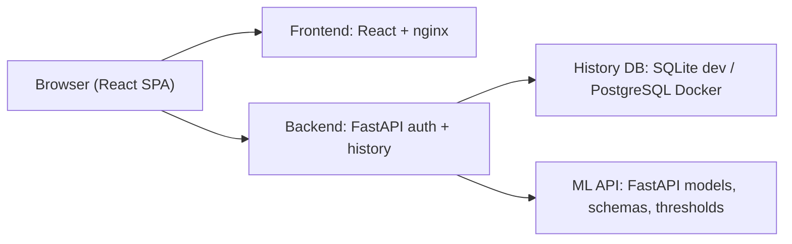
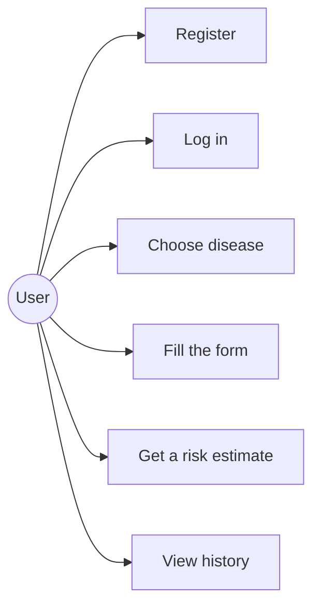
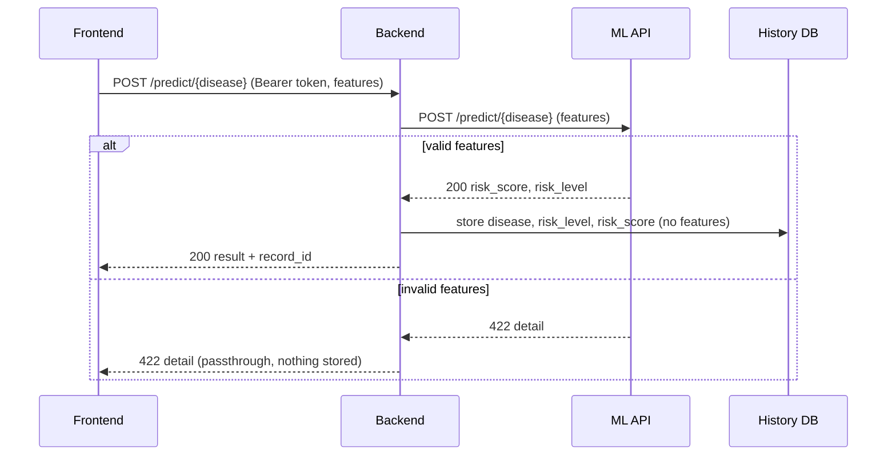
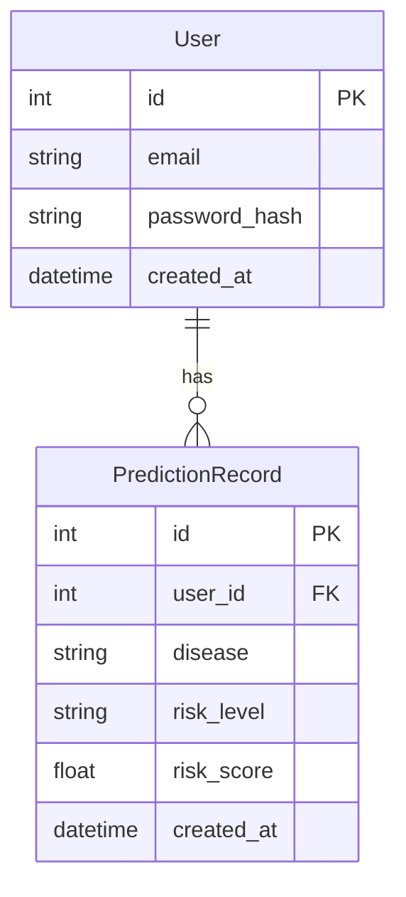
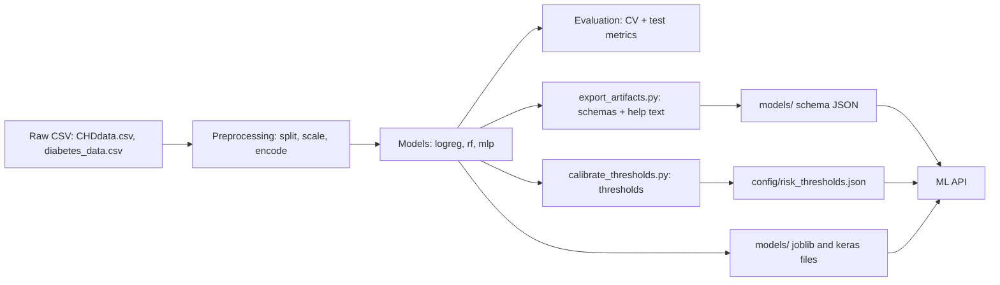
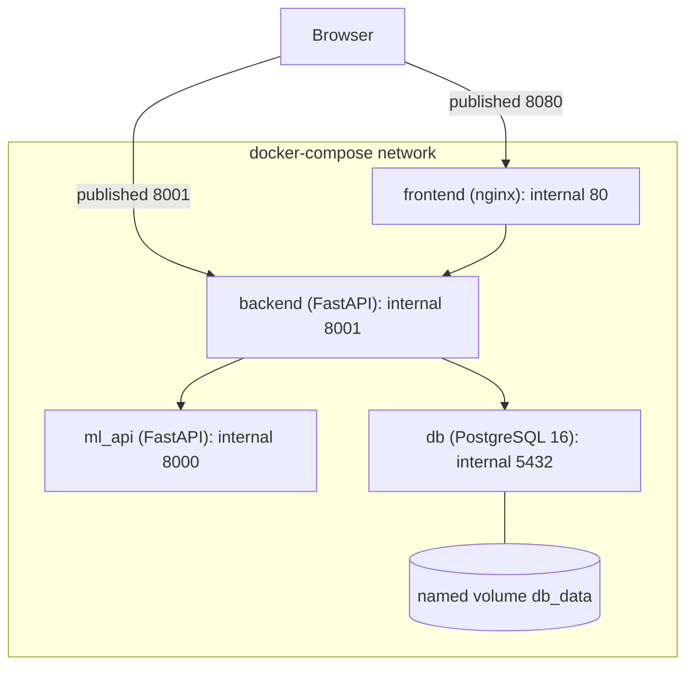

# Architecture

This document describes the MultiRisk AI MVP as it is implemented in this repository.
All endpoint fields, ports, and storage details below are read from the code
(`src/ml_api/main.py`, `src/backend/main.py`, `src/export_artifacts.py`,
`docker-compose.yml`).

## 1. Overview

MultiRisk AI estimates the **current** risk of two diseases from cross-sectional
data: Type 2 Diabetes and Cardiovascular Disease (CVD). It is a small
service-oriented application:

- A **browser** loads a React single-page app served by nginx.
- The **frontend** (nginx) serves static files and calls the **backend** over REST/JSON.
- The **backend** (FastAPI) handles authentication and prediction history, and
  proxies prediction and schema requests to the **ML API**.
- The **ML API** (FastAPI) loads trained models, schemas, and thresholds from disk
  and returns risk scores and levels.
- The **history database** stores users and prediction records. It is SQLite in
  development (the backend default `DATABASE_URL` is `sqlite:///./backend.db`) and
  PostgreSQL in Docker (`postgresql+psycopg://...`).

### Component diagram



## 2. Use cases

The single actor is the User.



## 3. Prediction sequence

The backend forwards the feature payload to the ML API. On success it stores a
record that contains only the disease, risk level, and risk score (never the
input features). On a `422` from the ML API it passes the error through and
stores nothing.



## 4. Data model

Two tables, read from `src/backend/main.py`.



`email` is unique and indexed. `password_hash` stores a bcrypt hash.
`created_at` is set to the current UTC time on insert.

## 5. Training and export data flow

Offline scripts produce the files that the ML API loads at startup.



## 6. Deployment (local docker-compose)

The stack runs with `docker compose`. Only the frontend and backend are published
to the host; the ML API and the database stay on the internal network.



Port and volume details:

| Service | Image / build | Internal port | Published to host | Notes |
|---------|---------------|---------------|-------------------|-------|
| frontend | `docker/frontend.Dockerfile` (nginx) | 80 | `${FRONTEND_PORT:-8080}` | serves the built SPA |
| backend | `docker/backend.Dockerfile` | 8001 | 8001 | `depends_on` ml_api (healthy) and db (healthy) |
| ml_api | `docker/ml.Dockerfile` | 8000 | none | healthcheck on `/health` |
| db | `postgres:16-alpine` | 5432 | none | named volume `db_data`, `pg_isready` healthcheck |

Backend environment in compose: `ENVIRONMENT=${ENVIRONMENT:-production}`,
`DATABASE_URL=postgresql+psycopg://...`, `ML_API_URL=http://ml_api:8000`,
`JWT_SECRET=${JWT_SECRET:?set JWT_SECRET}`,
`CORS_ORIGINS=${CORS_ORIGINS:-http://localhost:${FRONTEND_PORT:-8080}}`.

**AWS deployment is planned future work and is not implemented.** The repository
contains only the local docker-compose stack above; there are no AWS, Terraform,
or cloud deployment files.

## 7. API contract

### ML API (`src/ml_api/main.py`, port 8000)

| Method | Path | Auth | Request | Response |
|--------|------|------|---------|----------|
| GET | `/health` | none | – | `{status, diseases}` |
| GET | `/schema/{disease}` | none | path param `disease` in `{cvd, diabetes}` | schema object (see below); `404` unknown disease |
| POST | `/predict/{disease}` | none | `{features: {field: value}}` | prediction object (see below); `422` invalid features; `404` unknown disease |

Schema object fields: `raw_fields[]`, `family_history_field`, `population_note`,
`feature_columns[]`, `model_file`, `scaler_file`, `model_name`. Each entry of
`raw_fields` has `name`, `label`, `unit`, `help`, `type`, `train_min`, `train_max`,
`valid_min`, `valid_max`, and `allowed_values` for categorical fields.

Prediction object fields: `disease`, `model_name`, `risk_score`, `risk_level`,
`score_note`, `top_factors`, `disclaimer`; plus `factors_note` (logistic
regression only), `model_note` (diabetes only), `out_of_training_range` and
`range_warning` (only when a value falls outside the training range), and
`population_note` (always).

### Backend (`src/backend/main.py`, port 8001)

| Method | Path | Auth | Request | Response |
|--------|------|------|---------|----------|
| GET | `/health` | none | – | `{status}` |
| POST | `/auth/register` | none | `{email, password}` (password min length 8) | `201 {id, email}`; `409` duplicate email |
| POST | `/auth/login` | none | `{email, password}` | `{access_token, token_type}`; `401` invalid credentials |
| GET | `/me` | Bearer | – | `{id, email, created_at}` |
| GET | `/schema/{disease}` | none | path param `disease` | proxied schema; `503` if ML API unreachable |
| POST | `/predict/{disease}` | Bearer | `{features: {...}}` | ML prediction object + `record_id`; `422`/`404` passthrough; `503` unreachable; `502` other ML error |
| GET | `/history` | Bearer | – | list of `{id, disease, risk_level, risk_score, created_at}`, newest first |

## 8. Security and privacy

- **Stored data.** `User` rows store `id`, `email`, `password_hash`, `created_at`.
  `PredictionRecord` rows store `id`, `user_id`, `disease`, `risk_level`,
  `risk_score`, `created_at`. **Input feature values are never stored.**
- **Passwords.** Hashed with bcrypt (`bcrypt.hashpw` / `bcrypt.checkpw`); the
  plaintext password is never persisted.
- **Tokens.** JWT signed with HS256, 60-minute expiry, `sub` = user id
  (`JWT_EXPIRE_MINUTES = 60`). Protected endpoints require the Bearer token.
- **Secrets via environment.** `JWT_SECRET` and `POSTGRES_PASSWORD` are provided
  through the environment. `validate_settings(environment, jwt_secret)` runs at
  startup and raises `RuntimeError` when `ENVIRONMENT == "production"` and the
  secret is the default `dev-secret-change-me` or shorter than 32 characters. In
  development the default secret is allowed and a warning is printed.
- **Input validation.** Two levels: `valid_min`/`valid_max` are hard bounds and
  return `422` when violated; `train_min`/`train_max` are soft bounds and produce
  `out_of_training_range` plus a `range_warning` in the response.
- **Disclaimers.** Every prediction includes the disclaimer
  ("This is an estimate for academic demonstration, not a medical diagnosis.
  Consult a healthcare professional."), the score note ("Model score, not a
  calibrated probability: models were trained with balanced class weights."),
  and a per-disease `population_note`.
- **CORS.** The backend allows the configured `CORS_ORIGINS` (default
  `http://localhost:5173`, `http://localhost:3000`; in Docker
  `http://localhost:${FRONTEND_PORT:-8080}`).

## 9. Repository structure

```
multirisk-ai/
├── config/                     # field_help.json, risk_thresholds.json
├── data/                       # cardiovascular/CHDdata.csv, diabetes/diabetes_data.csv
├── docker/                     # ml.Dockerfile, backend.Dockerfile, frontend.Dockerfile, nginx.conf
├── docs/                       # ARCHITECTURE.md, METHODOLOGY_RESULTS.md, PHASE1_..., PHASE2_...
├── frontend/                   # React + Vite app (src/pages, src/components, src/api.js)
├── models/                     # cardiovascular/ and diabetes/ model, scaler, schema files
├── notebooks/                  # analysis notebooks
├── results/                    # baselines.csv, mlp.csv, summary.csv, diabetes_compact.csv, figures/
├── scripts/                    # smoke_test.py
├── src/
│   ├── backend/main.py         # auth + history service
│   ├── ml_api/main.py          # prediction service
│   ├── cardiovascular/preprocess.py
│   ├── diabetes/preprocess.py
│   ├── baselines.py            # logreg + rf baselines
│   ├── mlp.py                  # neural network baseline
│   ├── diabetes_compact.py     # compact diabetes model
│   ├── report.py               # summary, figures, final models
│   ├── family_history_check.py
│   ├── calibrate_thresholds.py
│   ├── export_artifacts.py     # schema + help export
│   └── eda.py
├── tests/                      # test_ml_api.py, test_backend.py
├── docker-compose.yml
├── requirements.txt
├── requirements-ml.txt
├── requirements-backend.txt
├── requirements-dev.txt
├── .env.example
└── .github/workflows/ci.yml
```
